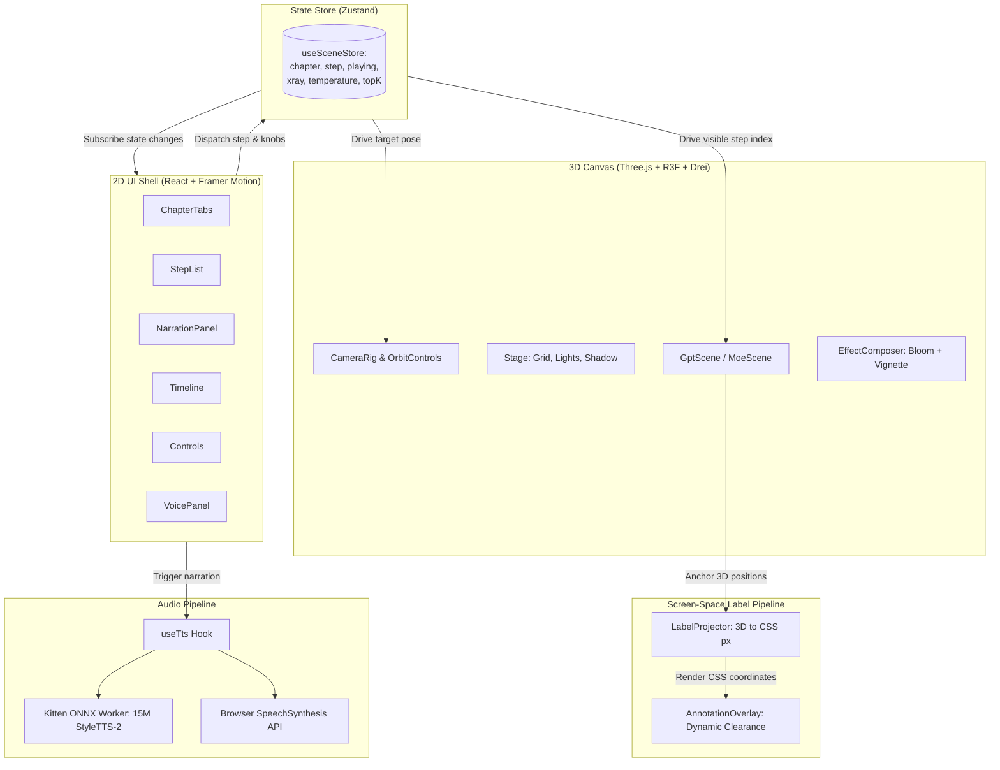
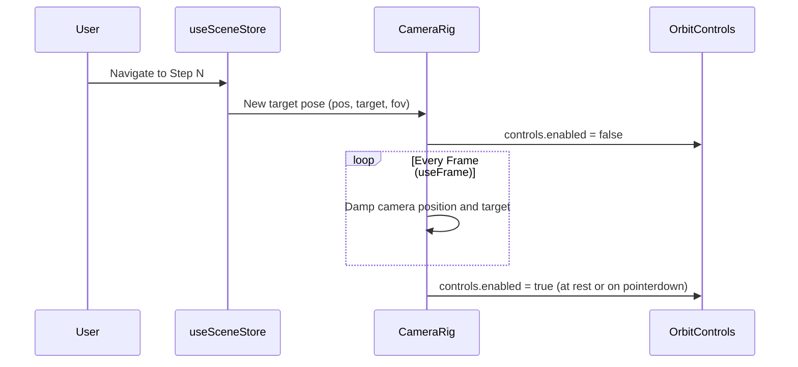
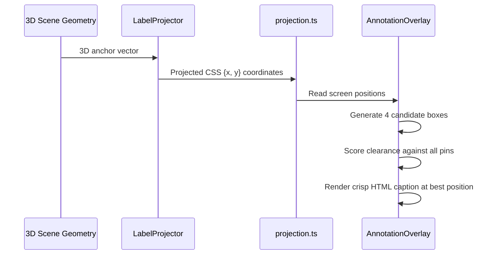

# System Architecture (`ARCHITECTURE.md`)
> **1-Line Summary:** Plain-English visual map of how the 19-step, camera-driven 3D explainer works, why we chose each tool, and step-by-step recipes for adding new features.

## 1. High-Level Visual System Map

---

## 2. Tech Stack & Why We Chose It

| Layer | Tool / Library | Plain-English Reason Why |
|---|---|---|
| Framework & Host | Vite 8 + React 19 + TypeScript | Instant HMR, static zero-config asset bundling, and clean declarative component lifecycle. |
| 3D Scene Graph | Three.js + `@react-three/fiber` + `@react-three/drei` | Declarative mapping of step visibility to component mounts, eliminating manual mesh lifecycle bugs. |
| Post-Processing | `@react-three/postprocessing` | Clean Bloom and Vignette effects in a single pass without custom GLSL boilerplate. |
| Global State | `zustand` | Lightweight reactive store accessible inside high-frequency `useFrame` render loops without re-rendering the DOM tree. |
| 2D UI Transitions | `framer-motion` | Smooth slide transitions for narration text cards when navigating between steps. |
| Neural Voice TTS | `kitten-tts-js` + `onnxruntime-web` | Highly compressed 15M-parameter neural TTS model running completely client-side in WebAssembly. |
| Linter | `oxlint` | Sub-100ms ultra-fast lint checks covering 116 strict React and TypeScript rules. |

---

## 3. Core Subsystems & Engineering Tricks

### [SUBSYSTEM: Camera-Rig-Damping] | Aliases: camera rig, orbit controls, smooth transition, fov damper
> **1-Line Summary:** Smoothly interpolates the camera position and focal target toward step presets while managing interaction lockouts.
* **How It Works (Plain English):** Each step defines a target `position`, `target`, and `fov`. `CameraRig` calculates per-frame damped motion using `THREE.MathUtils.damp`. To avoid jarring conflicts between automated glides and manual dragging, orbital controls are disabled during camera movement and re-enabled upon arrival or immediate user mouse-down.
* **Data Flow Diagram:**

* **Code Anchors (Grep Targets):**
  * `src/three/CameraRig.tsx` -> `CameraRig`
  * `src/content/types.ts` -> `CameraPose`

### [SUBSYSTEM: Screen-Space-Annotation-Projection] | Aliases: label projector, annotation overlay, candidate placement, occlusion clearance
> **1-Line Summary:** Projects 3D world coordinates into CSS screen space and dynamically scores candidate positions to prevent label occlusion.
* **How It Works (Plain English):** In-canvas text can suffer from perspective distortion and blur. Instead, `LabelProjector` converts 3D anchor points into screen-space pixel coordinates each frame. `AnnotationOverlay` generates candidate placements (top, bottom, left, right) and scores them against every other active pin, picking the placement with maximum visual clearance.
* **Data Flow Diagram:**

* **Code Anchors (Grep Targets):**
  * `src/three/labels/LabelProjector.tsx` -> `LabelProjector`
  * `src/three/labels/projection.ts` -> `projectPoint`
  * `src/three/labels/AnnotationOverlay.tsx` -> `placeCaptionCandidates`, `scoreCandidate`

### [SUBSYSTEM: Step-Visibility-And-Mesh-Damping] | Aliases: visibility window, damp, opacity fade, xray mesh
> **1-Line Summary:** Declares explicit step ranges `[from, to)` for meshes, ensuring instant bidirectional scrubbing without desynchronized animations.
* **How It Works (Plain English):** Meshes do not depend on forward-only timeline tweens. Instead, every visual primitive reads the current step from the store. If the step is within the visibility range, it smoothly damps opacity and scale up to 1; otherwise, it damps down to 0. Scrubbing backward or jumping steps is entirely safe and deterministic.
* **Code Anchors (Grep Targets):**
  * `src/three/shared/usePresence.ts` -> `usePresence`
  * `src/three/shared/NeonBox.tsx` -> `NeonBox`
  * `src/three/shared/VectorBar.tsx` -> `VectorBar`

### [SUBSYSTEM: Fast-Refresh-Scene-Data-Decoupling] | Aliases: scene constants, gptData, moeData, fast refresh, hot reloading
> **1-Line Summary:** Isolates numerical constants and token tables into pure data files to preserve React Fast Refresh during visual development.
* **How It Works (Plain English):** Vite's Fast Refresh mechanism requires component files to export only React components. Exporting data constants alongside components causes full module invalidation on every edit. Separating `gptData.ts` and `moeData.ts` allows editing math values, token weights, and expert counts while keeping the active 3D view preserved in the browser.
* **Code Anchors (Grep Targets):**
  * `src/scenes/gptData.ts` -> `LOGIT_VALUES`, `ATTENTION_WEIGHTS`
  * `src/scenes/moeData.ts` -> `computeMoeEconomics`, `ROUTER_WEIGHTS`
  * `src/scenes/GptScene.tsx` -> `GptScene`

### [SUBSYSTEM: Dual-Engine-TTS-Worker-Pipeline] | Aliases: kitten tts, web worker, single thread wasm, onnxruntime web
> **1-Line Summary:** Offloads neural speech generation to a background web worker with single-threaded WASM isolation to protect frame rate.
* **How It Works (Plain English):** Kitten TTS Nano (15M parameters) runs via `onnxruntime-web` inside a dedicated worker. To allow direct fetching from HuggingFace without requiring COEP/COOP headers that break cross-origin downloads, the worker wraps model initialization in a single-threaded override (`navigator.hardwareConcurrency = 1`).
* **Code Anchors (Grep Targets):**
  * `src/tts/kitten.worker.ts` -> `withSingleThread`, `MODEL_ID`
  * `src/tts/useTts.ts` -> `useTts`
  * `vite.config.ts` -> `optimizeDeps.include: ['jszip']`

---

## 4. Verification & Health Checks

### [VERIFY: Automated-Quality-Harness] | Aliases: test commands, lint, typecheck, label audit, contrast audit
> **1-Line Summary:** Commands required to prove type safety, clean linting, visual caption clearance, and contrast before any commit.
* **Type Check:** `npx tsc -b`
* **Lint Check:** `npm run lint` (runs `oxlint` across all files)
* **Production Build:** `npm run build` (`tsc -b && vite build`)
* **Caption Collision Audit:** `node .tools/audit.mjs labels` (verifies 0 overlaps and 0 out-of-bounds at multiple viewport widths)
* **Text Contrast Audit:** `node .tools/audit.mjs contrast` (WCAG AA verification across all rendered nodes)

---

## 5. Recipes: How to Add New Things Safely

### Recipe 1: Adding a New Explainer Step
1. Open `src/content/gptSteps.ts` (or `moeSteps.ts`).
2. Append a new `Step` definition with `id`, `title`, `narration`, `camera` pose, and `terms` list.
3. In `src/scenes/GptScene.tsx` (or `MoeScene.tsx`), place the corresponding 3D components and set their visibility window `[from, to)` to include the new step index.
4. Add screen-space indicator annotations in `src/scenes/annotations.ts`.
5. Run `npm run lint` and `npx tsc -b` to verify.

### Recipe 2: Adding a New Interactive Control
1. Add the state field and action in `src/state/useSceneStore.ts`.
2. Add the control slider or toggle component in `src/ui/Controls.tsx`.
3. Read the state in the target 3D component via `useSceneStore((s) => s.yourField)` and damp the affected geometry.
