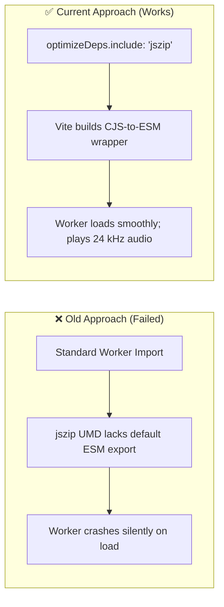
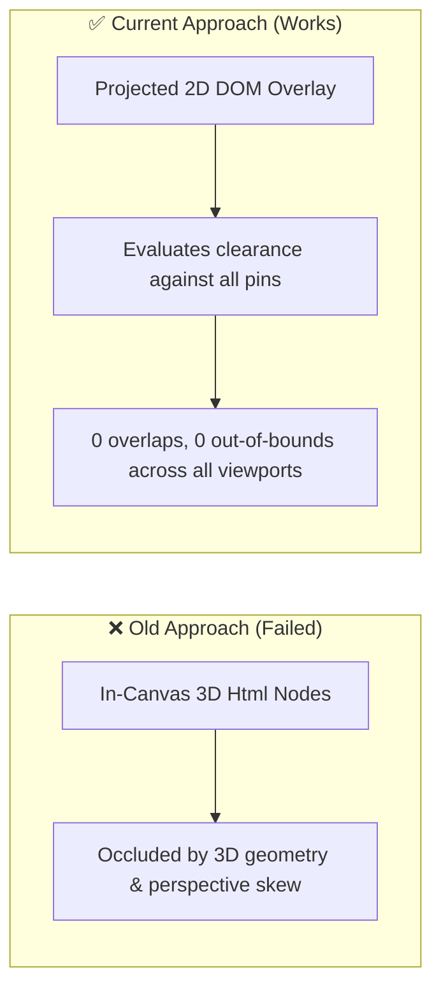

# Architectural Decisions, Pivots & Landmines (`DECISIONS_AND_TRAPS.md`)
> **1-Line Summary:** Records why we chose specific approaches, what failed when we tried other ways, who made the decision, and critical code traps never to touch.

## 1. Architectural Decisions & Pivot History

### [DECISION: Kitten-TTS-JS-Vite-ESM-Shim] | Aliases: kitten tts, worker crash, jszip import, vite optimizeDeps
> **1-Line Summary:** Pre-bundled `jszip` via Vite's `optimizeDeps` to prevent silent web worker crashes during neural voice loading.
* **Decision Maker:** `[DECIDED BY: AGENT - Approved by Human]`
* **Original User Intention:** Provide high-quality neural voice narration running locally in-browser without requiring backend API keys.
* **Options Considered:**
  * **Option A (Rejected):** Rely on default Vite worker bundling. Broke because `jszip` packages a UMD browser build lacking default ESM exports, silently crashing worker initialization.
  * **Option B (Chosen):** Explicitly include `jszip` in `optimizeDeps.include` in `vite.config.ts` so Vite generates ESM interop wrappers for worker module graphs.
* **Visual Pivot Map (What Failed vs. What Works):**

* **Code Anchors (Grep Targets):**
  * `vite.config.ts` -> `optimizeDeps.include`
  * `src/tts/kitten.worker.ts` -> `KittenTTS`

### [DECISION: Mathematically-Consistent-Logits-Distribution] | Aliases: logits sum, softmax normalization, gpt-2 small reference
> **1-Line Summary:** Normalized all displayed logits so their softmax distribution sums exactly to 1.000000 at temperature T=1.
* **Decision Maker:** `[DECIDED BY: AGENT - Approved by Human]`
* **Original User Intention:** Accurately teach probability distributions and temperature sampling without contradictory numbers.
* **Options Considered:**
  * **Option A (Rejected):** Heuristic bar heights summing to 1.24. This violated foundational probability theory and confused learners inspecting the numbers.
  * **Option B (Chosen):** Pinned GPT-2 small as the strict ground-truth reference model and recomputed logits with a designated vocabulary tail to guarantee a precise 1.000000 sum.
* **Visual Pivot Map (What Failed vs. What Works):**
```mermaid
flowchart LR
    subgraph Failed["❌ Old Approach (Failed)"]
        A1[Heuristic Logit Bars] --> A2[Sum = 1.24 (>1.0)]
        A2 --> A3[Violates probability mathematics]
    end
    subgraph Active["✅ Current Approach (Works)"]
        B1[Pinned GPT-2 small reference] --> B2[Exact distribution + tail category]
        B2 --> B3[Sum = 1.000000 at T = 1]
    end
```
* **Code Anchors (Grep Targets):**
  * `src/scenes/gptData.ts` -> `LOGIT_VALUES`, `LOGIT_SUM`

### [DECISION: Anchor-Aware-Screen-Space-Caption-Clearance] | Aliases: caption overlap, clear placement, 2d labels, candidate scoring
> **1-Line Summary:** Replaced 3D in-canvas text with dynamic screen-space DOM candidate scoring to eliminate geometry collisions.
* **Decision Maker:** `[DECIDED BY: AGENT - Approved by Human]`
* **Original User Intention:** Deliver razor-sharp, readable annotations that never cover the 3D structures they describe.
* **Options Considered:**
  * **Option A (Rejected):** In-canvas `@react-three/drei` `<Html>` nodes. Suffered from text blur, perspective rotation, and occlusion by adjacent 3D meshes.
  * **Option B (Chosen):** 2D DOM overlay evaluating four candidate positions (top, bottom, left, right) each frame, picking the candidate with the highest clearance score against all active pins.
* **Visual Pivot Map (What Failed vs. What Works):**

* **Code Anchors (Grep Targets):**
  * `src/three/labels/AnnotationOverlay.tsx` -> `placeCaptionCandidates`, `scoreCandidate`
  * `src/three/labels/LabelProjector.tsx` -> `LabelProjector`

---

## 2. Do-Not-Touch Engineering Landmines (Traps)

### [TRAP: Single-Thread-WASM-Override] | Aliases: crossOriginIsolated, coep coop, hugginface cdn, hardwareConcurrency
> **1-Line Summary:** Never remove the single-threaded WASM override in kitten.worker.ts, or neural voice downloads from HuggingFace will fail.
* **Strict Rule:** **NEVER** enable multi-threaded WASM or remove the `withSingleThread` hardware concurrency override in `src/tts/kitten.worker.ts`.
* **Why This Trap Exists (Plain English):** Multi-threaded WebAssembly requires `crossOriginIsolated` headers (COOP and COEP). Enabling COEP blocks model asset downloads from the external HuggingFace CDN unless every upstream CDN opts in with CORP. `kitten-tts-js` forcibly attempts to set threads to `navigator.hardwareConcurrency` on initialization. Pinning it to 1 thread ensures reliable model downloading and execution without frame drops.
* **Protected Code Anchors (Grep Targets):**
  * `src/tts/kitten.worker.ts` -> `withSingleThread`

### [TRAP: Windows-Dev-Server-File-Locking] | Aliases: ReplaceFileW EIO, file watcher, port 5174, bulk refactors
> **1-Line Summary:** Always terminate running dev server processes before executing large file operations on Windows.
* **Strict Rule:** **NEVER** execute large automated file rewrites or renames while the Vite dev server is actively running on port 5174/5173.
* **Why This Trap Exists (Plain English):** Windows OS locks file handles held by the Vite file watcher. Attempting to bulk-write or rename files while the watcher is running triggers fatal `ReplaceFileW EIO` filesystem errors. Always run `stop-server.bat` before mass operations.
* **Protected Code Anchors (Grep Targets):**
  * `start-server.bat`
  * `stop-server.bat`

### [TRAP: Scene-Data-Export-Separation] | Aliases: fast refresh, react only-export-components, hot reloading
> **1-Line Summary:** Never export numerical arrays or constants from scene component files like GptScene.tsx.
* **Strict Rule:** **NEVER** place raw numerical data, step arrays, or token weights directly in `src/scenes/GptScene.tsx` or `src/scenes/MoeScene.tsx`.
* **Why This Trap Exists (Plain English):** React Fast Refresh requires that component files export only React components. Exporting data constants alongside components causes Vite to invalidate the entire module graph on edit, forcing a full browser page refresh that resets the user's active chapter and step position.
* **Protected Code Anchors (Grep Targets):**
  * `src/scenes/gptData.ts` -> `LOGIT_VALUES`
  * `src/scenes/moeData.ts` -> `computeMoeEconomics`
  * `src/scenes/GptScene.tsx` -> `GptScene`
