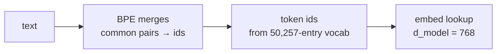
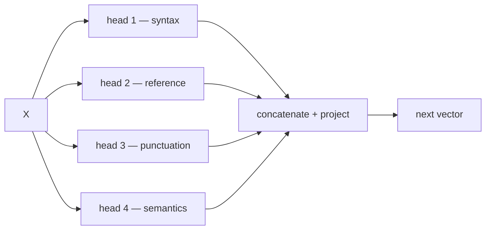
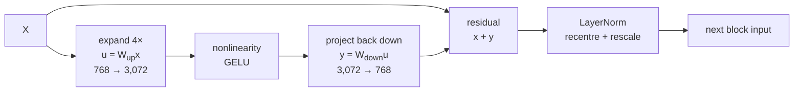
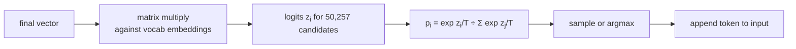
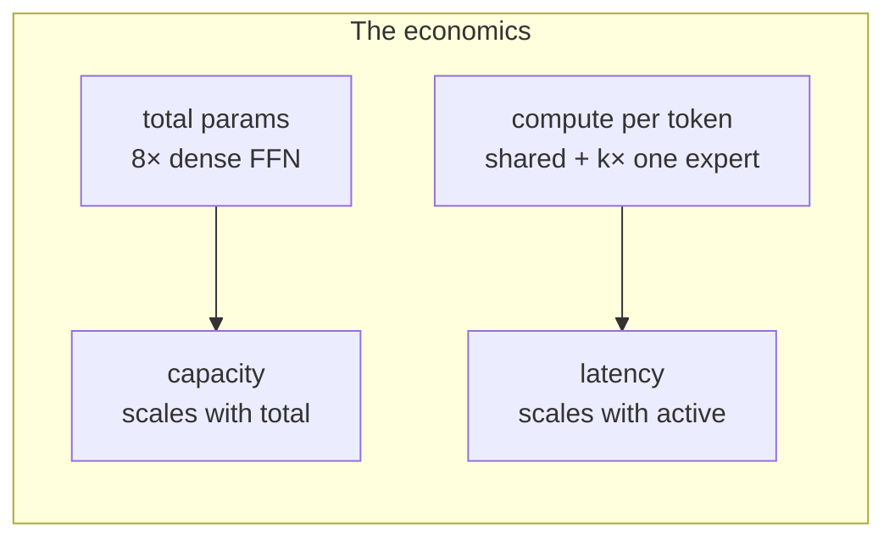
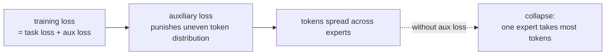

# Algorithms Reference (`algorithms.md`)
> **1-Line Summary:** Mathematical formulations, data representations, and step-by-step algorithms behind the 3D visualisations.

How each visualised process actually works, in plain language with the formulas behind it.

**The reference model throughout is GPT-2 small** — 768-wide vectors, 12 heads, 12 blocks, a 3,072-wide FFN, a 1,024-token context, and a 50,257-token vocabulary — so the numbers below agree with each other. Where a figure comes from a different model, that model is explicitly named.

---

## 1. High-Level Transformer Pipeline

### [SUBSYSTEM: GPT-End-To-End-Generation] | Aliases: gpt pipeline, token generation, transformer loop
> **1-Line Summary:** Complete sequential flow of autoregressive token generation from raw text input to sampling and recurrence.


* **Code Anchors (Grep Targets):**
  * `src/content/gptSteps.ts` -> `gptSteps`
  * `src/scenes/GptScene.tsx` -> `GptScene`

---

## 2. Tokenization & Embedding

### [SUBSYSTEM: BPE-Tokenization-And-Embedding] | Aliases: bpe, byte pair encoding, token ids, embedding lookup
> **1-Line Summary:** Translates raw character byte sequences into token IDs and maps them to dense continuous vector space.



Common words stay whole ("The" → 464); rare words split ("unbelievable" → un·believ·able). The model only ever sees IDs — a 50,257-entry lookup table, not language. The fallback unit is a raw **byte**, so any string is representable without an "unknown token".

* **Code Anchors (Grep Targets):**
  * `src/scenes/gptData.ts` -> `TOKENS`
  * `src/three/shared/TokenChip.tsx` -> `TokenChip`

---

## 3. Attention Mechanisms

### [SUBSYSTEM: Causal-Self-Attention] | Aliases: qkv, query key value, scaled dot-product, causal mask
> **1-Line Summary:** Computes token-to-token attention weights via scaled dot products with causal future masking.

```mermaid
flowchart LR
    X[token vectors] --> Q[Q = XW<sup>Q</sup>\n"what am I asking?"]
    X --> K[K = XW<sup>K</sup>\n"what do I say I am?"]
    X --> V[V = XW<sup>V</sup>\n"what do I hand over?"]
    Q --> S1[scores = QKᵀ / √d<sub>k</sub>]
    K --> S1
    S1 --> MASK[causal mask\nzero every j > i]
    MASK --> W[softmax rows → weights\nsum to 1 per row]
    W --> O[output = W·V\nweighted blend of all tokens]
```

The visualization's heatmap is exactly the `W` matrix: each row is one token's distribution over every other token. The arcs are its top entries. Cells above the diagonal are masked flat — that region is where "the future" would have been, drawn dark so causality is visible.

* **Code Anchors (Grep Targets):**
  * `src/scenes/gptData.ts` -> `ATTENTION_WEIGHTS`
  * `src/three/shared/HeatmapPlane.tsx` -> `HeatmapPlane`
  * `src/three/shared/Arc.tsx` -> `Arc`

### [SUBSYSTEM: Multi-Head-Attention] | Aliases: multi head, parallel attention, head projection
> **1-Line Summary:** Runs multiple independent attention heads in parallel to capture distinct linguistic relationships.



Different heads specialise during training (emergent, not hand-designed). The visualization shows 4 heads of 64 dimensions; GPT-2 small runs 12 heads, and modern frontier models use 96+.

* **Code Anchors (Grep Targets):**
  * `src/scenes/GptScene.tsx` -> `MultiHead`

---

## 4. Feed-Forward & Residual Networks

### [SUBSYSTEM: Feed-Forward-And-Residual-Stream] | Aliases: ffn, gelu, layernorm, residual highway
> **1-Line Summary:** Expands vector width 4× with GELU non-linearity and adds residual skip connections for stable backpropagation.



Roughly two-thirds of a transformer's parameters live in the FFN, and because it is position-wise it is the natural place to split into experts. The residual highway lets the original signal skip every sub-layer unchanged — that is what makes 100+ layers trainable.

* **Code Anchors (Grep Targets):**
  * `src/three/shared/NeonBox.tsx` -> `NeonBox`
  * `src/three/shared/Tower.tsx` -> `Tower`

---

## 5. Output Logits, Softmax & Temperature Sampling

### [SUBSYSTEM: Logits-Softmax-Sampling] | Aliases: temperature sampling, logits, softmax, next token
> **1-Line Summary:** Projects final hidden vectors to vocabulary logits, computes softmax probabilities, and samples next tokens based on temperature.



Temperature `T` is pure post-processing: `T → 0` sharpens the distribution toward the argmax; `T = 1` is the raw softmax; `T > 1` flattens it. The scene redraws the bar chart live as the temperature slider moves.

The chart draws **six bars, renormalised to sum to 1**, not the full vocabulary. The other 50,251 tokens hold a long tail described in the narration.

* **Code Anchors (Grep Targets):**
  * `src/scenes/gptData.ts` -> `LOGIT_VALUES`, `LOGIT_SUM`
  * `src/three/shared/BarChart.tsx` -> `BarChart`

---

## 6. Mixture of Experts (MoE) Architecture

### [SUBSYSTEM: MoE-Gating-And-Top-K-Routing] | Aliases: moe router, top-k selection, expert dispatch, sparse gating
> **1-Line Summary:** Replaces the dense FFN with sparse routing that directs each token to the Top-K most relevant expert networks.

```mermaid
flowchart LR
    subgraph MoE["MoE layer — replaces the FFN"]
        TOK[token vector] --> GATE[linear gate\nscores = W<sub>g</sub> x]
        GATE --> TOPK[top-k selection\ndrop the rest]
        TOPK --> E1[expert 1]
        TOPK --> E2[expert 2]
        TOPK -.-> E8[expert 8\ndormant — no compute]
        E1 & E2 --> MERGE[weighted sum\nΣ w<sub>i</sub> · expert<sub>i</sub>(x)]
    end
    MERGE --> RES[residual stream]
```

The router is one matrix multiply — a fraction of an FFN's cost. Only the top-k experts run; the other (8−k) experts' parameters are never touched for this token. The retained weights are renormalised so they sum to 1 before the merge.

* **Code Anchors (Grep Targets):**
  * `src/scenes/moeData.ts` -> `ROUTER_WEIGHTS`, `EXPERT_COUNT`
  * `src/scenes/MoeScene.tsx` -> `MoeScene`

### [SUBSYSTEM: MoE-Parametric-Economics] | Aliases: moe economics, active parameters, flop savings
> **1-Line Summary:** Decouples total model capacity from per-token compute costs, enabling sub-linear latency growth.



The worked example is a **134B-parameter / 8-expert** network with 30B shared parameters and 13B per expert, so active compute is `30B + k × 13B`:

| k | Active params | Saving vs dense |
|---|---|---|
| 1 | 43B | 3.1× |
| 2 | 56B | 2.4× |
| 4 | 82B | 1.6× |

Reference models: Mixtral 8×7B (46.7B total, ~12.9B active with k = 2) and DeepSeek-V3 (671B total, 37B active).

* **Code Anchors (Grep Targets):**
  * `src/scenes/moeData.ts` -> `computeMoeEconomics`

### [SUBSYSTEM: Expert-Load-Balancing] | Aliases: aux loss, auxiliary loss, router collapse, capacity factor
> **1-Line Summary:** Applies auxiliary routing loss during training to distribute tokens evenly across experts and prevent collapse.



The visualization animates both states: one expert at 62% with load balancing off; roughly even spread with it on. A capacity factor caps how many tokens each expert will take, preventing buffer overflow during parallel dispatch.

* **Code Anchors (Grep Targets):**
  * `src/scenes/moeData.ts` -> `LOAD_BALANCED_DIST`, `COLLAPSED_DIST`
  * `src/scenes/MoeScene.tsx` -> `MoeScene`
