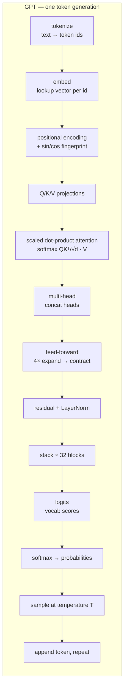
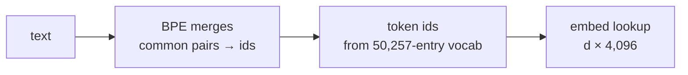
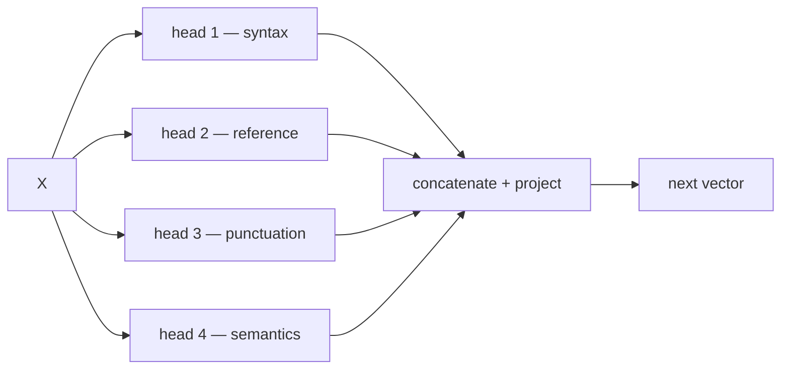
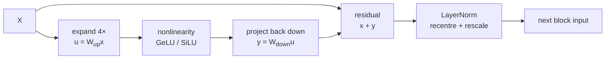
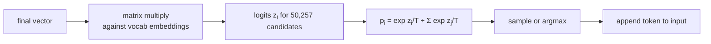
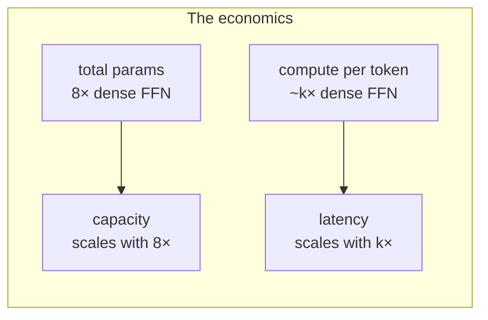
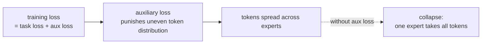
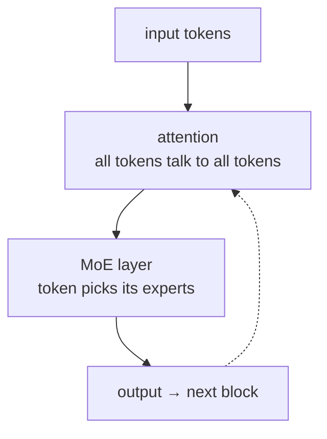
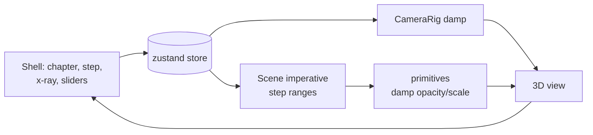

# Algorithms & Flowcharts

How each visualised process actually works, in plain language with the formulas behind it.

## 1. GPT pipeline, end to end



## 2. Tokenization



Common words stay whole ("The" → 464); rare words split ("unbelievable" → un·believ·able). The model only ever sees ids — a 50,257-entry lookup table, not language.

## 3. Self-attention

```mermaid
flowchart LR
    X[token vectors] --> Q[Q = XW<sup>Q</sup>\n"what am I asking?"]
    X --> K[K = XW<sup>K</sup>\n"what do I say I am?"]
    X --> V[V = XW<sup>V</sup>\n"what do I hand over?"]
    Q --> S1[scores = QKᵀ / √d<sub>k</sub>]
    K --> S1
    S1 --> W[softmax rows → weights\nsum to 1 per row]
    W --> O[output = W·V\nweighted blend of all tokens]
```

The viz's heatmap is exactly the `W` matrix: each row is one token's distribution over every other token. The arcs are its top entries.

## 4. Multi-head attention



Different heads specialise during training (this is emergent, not hand-designed). The viz shows 4; real models run 32–128.

## 5. Feed-forward + residual



~67% of a transformer's parameters live in the FFN. The residual highway lets the original signal skip every sub-layer unchanged — that is what makes 100+ layers trainable.

## 6. Logits, softmax, sampling



Temperature `T` is pure post-processing: `T→0` sharpens the distribution toward the argmax; `T=1` is the raw softmax; `T>1` flattens it. The viz redraws the bar chart live as you drag the slider.

## 7. Mixture of Experts

```mermaid
flowchart LR
    subgraph MoE["MoE layer — replaces the FFN"]
        TOK[token vector] --> GATE[linear gate\nscores = W<sub>g</sub> x]
        GATE --> TOPK[top-k selection\ndrop the rest]
        TOPK --> E1[expert 1]
        TOPK --> E2[expert 2]
        TOPK -.-> E8[expert 8\ndormant — no compute]
        E1 & E2 --> MERGE[weighted sum\nΣ w<sub>i</sub> · expert<sub>i</sub>(x)]
    end
    MERGE --> RES[residual stream]
```

The router is one matrix multiply — ~0.1% of an FFN's cost. Only the top-k experts run; the other (8−k) experts' parameters are never touched for this token.



MoE decouples capacity (what makes a model smart) from per-token compute (what makes it slow). That is the entire value proposition.

## 8. Load balancing



The viz's histogram animates both states: one expert at 62% with load balancing off; roughly even spread with it on. This is a training-time concern — at inference the router is frozen.

## 9. Where MoE lives in a transformer



Attention is untouched. MoE only swaps the FFN. Mixtral, DeepSeek, and GPT-4-class models all use this exact pattern: dense attention + sparse MoE, repeated.

## 10. The app's own loop (meta)



No framework code here — the app is a pure function of `(chapter, step, knobs)`; everything on screen re-derives from that state every frame.
