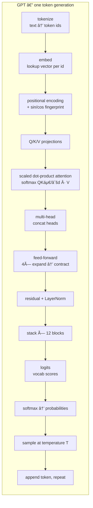
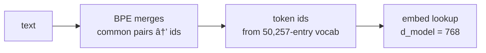
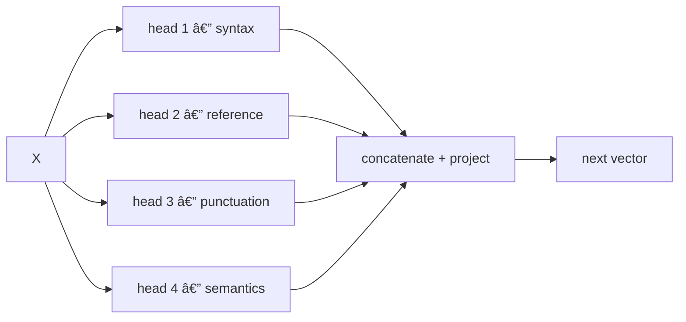
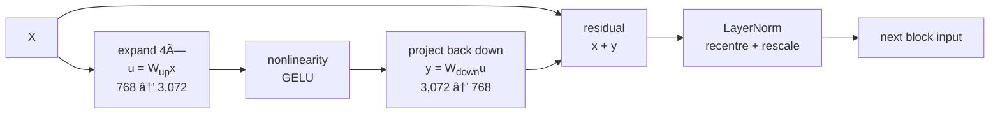
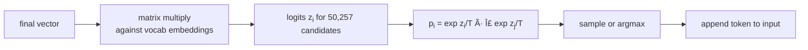
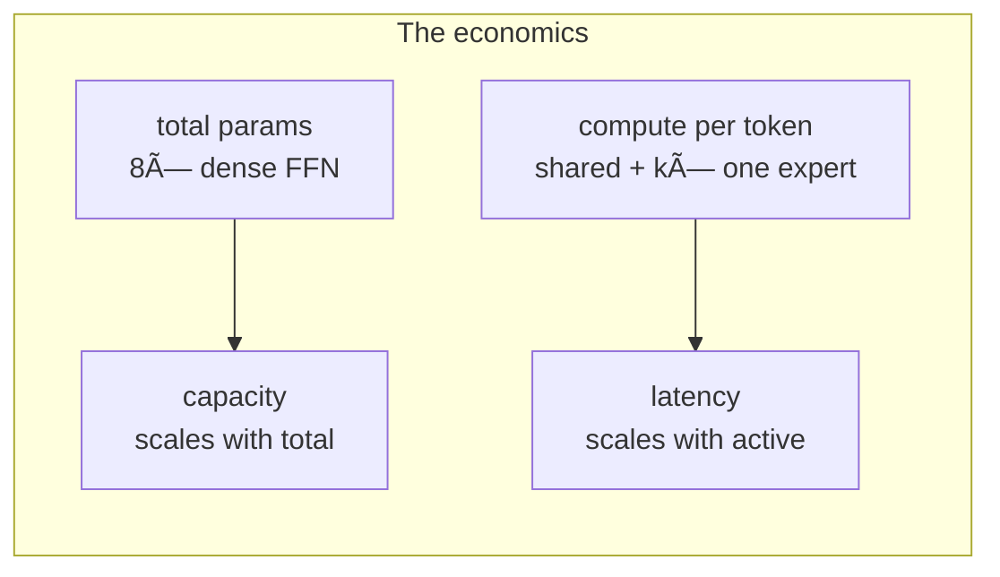
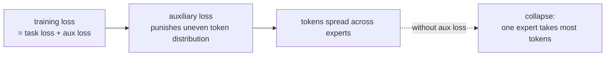
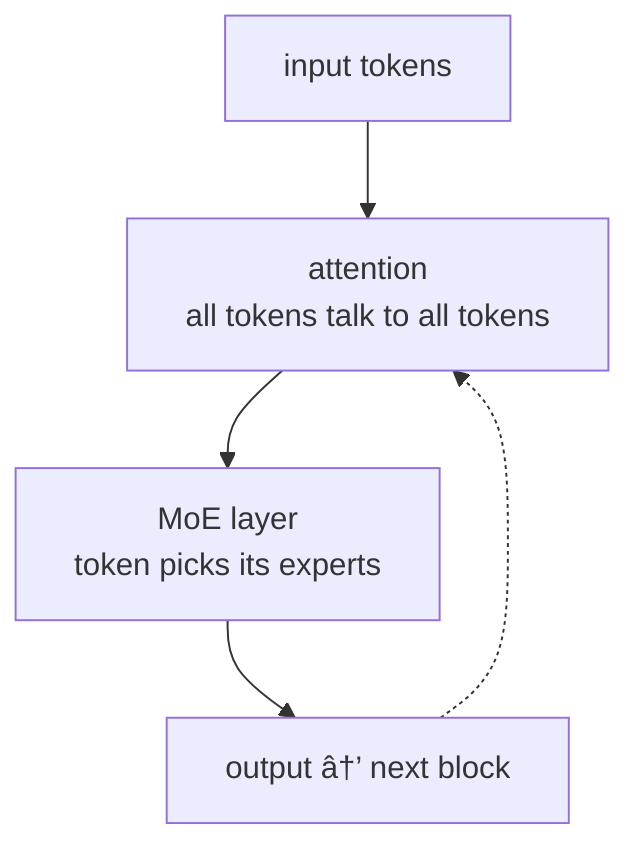
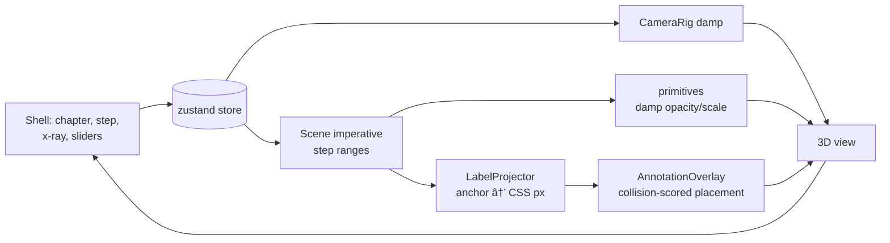

# Algorithms -- Algorithm Reference

> **1-Line Summary:** The maths behind each visualised step.

How each visualised process actually works, in plain language with the formulas
behind it.

**The reference model throughout is GPT-2 small** — 768-wide vectors, 12 heads,
12 blocks, a 3,072-wide FFN, a 1,024-token context and a 50,257-token vocabulary
— so the numbers below agree with each other. Where a figure comes from a
different model, that model is named.

## 1. GPT pipeline, end to end



## 2. Tokenization



Common words stay whole ("The" → 464); rare words split ("unbelievable" →
un·believ·able). The model only ever sees ids — a 50,257-entry lookup table, not
language. The fallback unit is a raw **byte**, so any string is representable
without an "unknown token".

## 3. Self-attention

```mermaid
flowchart LR
    X[token vectors] --> Q[Q = XW<sup>Q</sup>\n"what am I asking?"]
    X --> K[K = XW<sup>K</sup>\n"what do I say I am?"]
    X --> V[V = XW<sup>V</sup>\n"what do I hand over?"]
    Q --> S1[scores = QKᵀ / √d<sub>k</sub>]
    K --> S1
    S1 --> MASK[causal mask\nzero every j > i]
    MASK --> W[softmax rows → weights\nsum to 1 per row]
    W --> O[output = W·V\nweighted blend of all tokens]
```

The viz's heatmap is exactly the `W` matrix: each row is one token's distribution
over every other token. The arcs are its top entries. Cells above the diagonal
are masked flat — that region is where "the future" would have been, and it is
drawn dark on purpose so the causal claim is visible rather than asserted.

## 4. Multi-head attention



Different heads specialise during training (emergent, not hand-designed). The viz
shows 4 heads of 64 dimensions; GPT-2 small runs 12, and frontier models 96+.

## 5. Feed-forward + residual



Roughly two-thirds of a transformer's parameters live in the FFN, and because it
is position-wise it is the natural place to split into experts. The residual
highway lets the original signal skip every sub-layer unchanged — that is what
makes 100+ layers trainable.

## 6. Logits, softmax, sampling



Temperature `T` is pure post-processing: `T→0` sharpens the distribution toward
the argmax; `T=1` is the raw softmax; `T>1` flattens it. The viz redraws the bar
chart live as you drag the slider.

The chart draws **six bars, renormalised to sum to 1**, not the full vocabulary.
That is honest for comparing candidates relative to each other, but it is not the
true marginal probability of any one of them — the other 50,251 tokens hold a long
tail that is described in the narration instead of drawn. A single "everything
else" bar was tried and rejected: at `T = 1.5` it swells to 64% and at `T = 2` to
94%, flattening the six bars it is supposed to sit beside.

## 7. Mixture of Experts

```mermaid
flowchart LR
    subgraph MoE["MoE layer — replaces the FFN"]
        TOK[token vector] --> GATE[linear gate\nscores = W<sub>g</sub> x]
        GATE --> TOPK[top-k selection\ndrop the rest]
        TOPK --> E1[expert 1]
        TOPK --> E2[expert 2]
        TOPK -.-> E8[expert 8\ndormant — no compute]
        E1 & E2 --> MERGE[weighted sum\nΣ w<sub>i</sub> · expert<sub>i</sub>(x)]
    end
    MERGE --> RES[residual stream]
```

The router is one matrix multiply — a fraction of an FFN's cost. Only the top-k
experts run; the other (8−k) experts' parameters are never touched for this token.
The retained weights are **renormalised** so they sum to 1 before the merge.



MoE decouples capacity (what makes a model smart) from per-token compute (what
makes it slow). That is the entire value proposition.

The worked example is a **134B-parameter / 8-expert** network with 30B shared
parameters and 13B per expert, so active compute is `30B + k × 13B`:

| k | Active params | Saving vs dense |
|---|---|---|
| 1 | 43B | 3.1× |
| 2 | 56B | 2.4× |
| 4 | 82B | 1.6× |

Those are the numbers the economics step computes from the live `k` knob — the
bar heights come from the same arithmetic, not from a hard-coded picture. For
scale, the real models named in the chapter are Mixtral 8×7B (46.7B total, ~12.9B
active with k = 2) and DeepSeek-V3 (671B total, 37B active).

Note the shape of the trade: k = 2 on this network spends 56B of compute for 134B
of capacity. Nothing is free at k = 0 either — 30B of shared parameters
(embeddings, attention, router, LayerNorms) run for every token regardless.

## 8. Load balancing



The viz's histogram animates both states: one expert at 62% with load balancing
off; roughly even spread with it on. This is a training-time concern — at
inference the router is frozen, but the damage done during training is permanent.
A capacity factor caps how many tokens each expert will take, and tokens over the
cap are dropped, which is the second half of the same problem.

## 9. Where MoE lives in a transformer



Attention is untouched and stays dense. MoE only swaps the FFN, which is why it
drops into an existing architecture — Mixtral, DeepSeek-V3 and GPT-4-class models
all use this pattern: dense attention + sparse MoE, repeated.

## 10. The app's own loop (meta)



No framework code here — the app is a pure function of `(chapter, step, knobs)`;
everything on screen re-derives from that state every frame.


