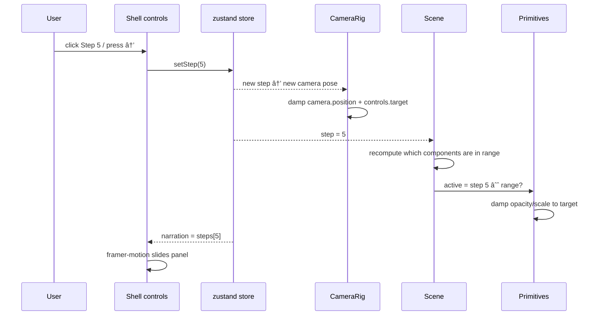
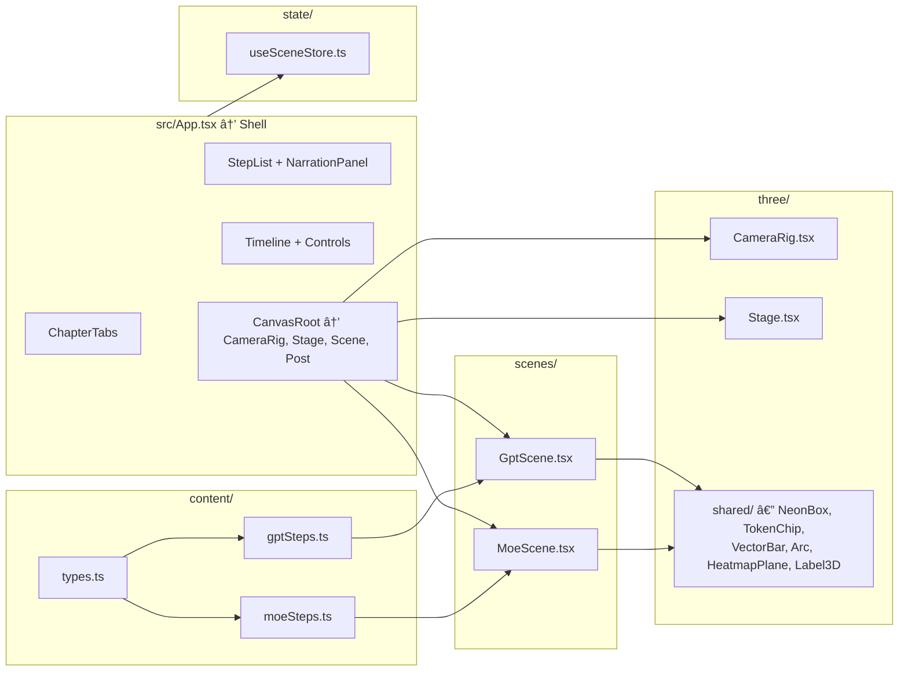

# Architecture

## What this is

A single-page 3D explainer that turns two ML ideas — **how GPT works** and **how Mixture of Experts works** — into scripted, camera-driven step sequences. The user does not read a wall of text; they watch a scene animate through 19 steps (11 GPT + 8 MoE), with narration, stats, and live sliders anchored to the right moments.

## Why this stack

| Layer | Choice | Why |
|---|---|---|
| Build | Vite + React + TypeScript | Fast HMR, trivial static build, no bundler config beyond the template. Chosen over a single HTML file because step-driven state (chapter, step, x-ray, sliders) is much easier to keep consistent in React than in imperative DOM code. |
| 3D | `three` + `@react-three/fiber` + `@react-three/drei` | Declarative scene graph that maps cleanly to "component appears at step N, dims at step M". The alternative — hand-rolled Three.js in a vanilla page — forces manual lifecycle management for every mesh. |
| Glow | `@react-three/postprocessing` (Bloom, Vignette) | One `EffectComposer` gives the neon look for free; no custom shaders. |
| State | `zustand` | A single tiny store (chapter, step, toggles, sliders) readable from both the 2D UI and inside `useFrame` loops without re-renders. Redux would be overkill for ~10 fields. |
| UI motion | `framer-motion` | Narration panel slide on step change. |
| Lint | `oxlint` (Vite template default) | Fast, zero-config. |

## System architecture

```mermaid
flowchart TB
    subgraph Shell["UI Shell (2D)"]
        CT[ChapterTabs]
        SL[StepList]
        NP[NarrationPanel]
        TL[Timeline]
        CTL[Controls]
    end
    subgraph Store["zustand store\nuseSceneStore"]
        ST[(chapter, step, playing,\nxray, labels, temperature,\ntopK, loadBalancing)]
    end
    subgraph Content["Content data"]
        GPT[gptSteps.ts — 11 steps]
        MOE[moeSteps.ts — 8 steps]
        TYP[types.ts — Step, CameraPose]
    end
    subgraph CanvasLayer["CanvasRoot"]
        CAM[CameraRig]
        STAGE[Stage — grid, shadows, dust]
        SCENE["GptScene / MoeScene"]
        POST[EffectComposer — Bloom + Vignette]
    end
    subgraph Primitives["3D primitives (shared)"]
        NB[NeonBox]
        TC[TokenChip]
        VB[VectorBar]
        ARC[Arc — Bézier tubes]
        HM[HeatmapPlane]
        LBL[Label3D — drei Html]
    end

    Shell -->|setChapter / setStep / toggles| Store
    Store -->|subscribes| Shell
    Store -->|step + camera| CAM
    Store -->|step| SCENE
    GPT -->|steps, camera, active[]| SCENE
    MOE -->|steps, camera, active[]| SCENE
    TYP --> GPT & MOE
    CAM -->|damps camera pos + target| SCENE
    SCENE --> Primitives
    Primitives -->|xray, step| Store
    STAGE --> CanvasLayer
    POST --> CanvasLayer
```

## Data flow



## The core trick: step ranges + damping

Every visual component declares a **visibility window** `[from, to)` in step space. When the current step is inside the window the component is at full opacity; outside it scales to zero / fades. Positions never jump — they **damp** toward their target with `THREE.MathUtils.damp(cur, target, λ, dt)` inside `useFrame`.

That is what makes scrubbing backwards safe: there is no timeline of tweens to desync. The UI is a pure function of `(chapter, step)` plus a few knobs; the 3D scene is a pure function of the same state. Scrub to any step, any direction, and everything re-derives.

## The CameraRig trick

`CameraRig` damps `camera.position` and `controls.target` toward `steps[step].camera`. While gliding it sets `controls.enabled = false` so the user cannot fight the animation. The moment the camera reaches the target, or on any `pointerdown`, it hands control back to OrbitControls. Without this gate, damping and user orbit fight each other every frame.

## X-ray mode

One global boolean. Materials read it in their `useFrame`: outer shells drop to `opacity ≈ 0.12, depthWrite = false` and gain `<Edges>` outlines, while inner vectors/arcs go to full opacity. That is the "look inside the block" moment — the residual rail, the vectors inside NeonBoxes, the active experts behind dormant ones.

## File map



## Deliberate simplifications

- **Illustrative numbers only.** No tokenizer, no real weights, no model inference. The goal is a correct mental model, not a runnable LLM.
- **6 tokens, 8 experts, 4 heads** instead of real dimensions (4,096 / 96 heads). Small enough to fit a viewport, large enough to convey the shape.
- **No test suite** beyond a typecheck + build. The plan called for a Vitest spec asserting step id uniqueness; `tsc -b` plus a manual walk-through of the 19 steps catches the failure modes that actually matter (a broken step id shows up as an empty scene).
- **One big bundle** (~1.5 MB JS, 430 KB gzip). Fine for a local explainer; code-splitting would help if this ever got deployed to a slow connection.

## How to develop it further

- Add a step: append a `Step` object to `gptSteps.ts` / `moeSteps.ts` with a camera pose and `active[]` ids, then add the matching components to the scene with the right `[from, to)` range. Nothing else changes.
- Add a chapter: new `ChapterDef`, new scene file, register in `chapters` in `moeSteps.ts`, add a `Chapter` union member in `types.ts`.
- Add a knob: add a field to `useSceneStore`, a control in `NarrationPanel`, and read it in the scene.

## Where things live in the home folder

- **Runtime (npm + Node):** `C:\Program Files\nodejs\` — system-wide, on PATH. Any app, harness, or script can run `node` / `npm`.
- **This explainer (source + docs + start/stop):** `C:\Users\kazir\Documents\Agentic Harness\GPT-MoE-3D-Explainer\`

To move the project, copy that whole `GPT-MoE-3D-Explainer` folder. `node_modules/` is regenerable (`npm install`) and `dist/` is regenerable (`npm run build`); neither needs to be copied.
