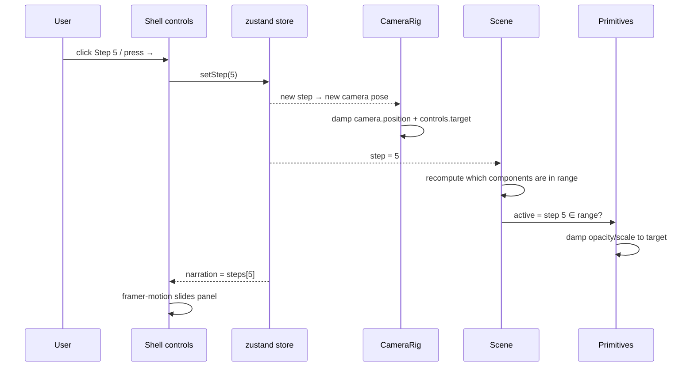
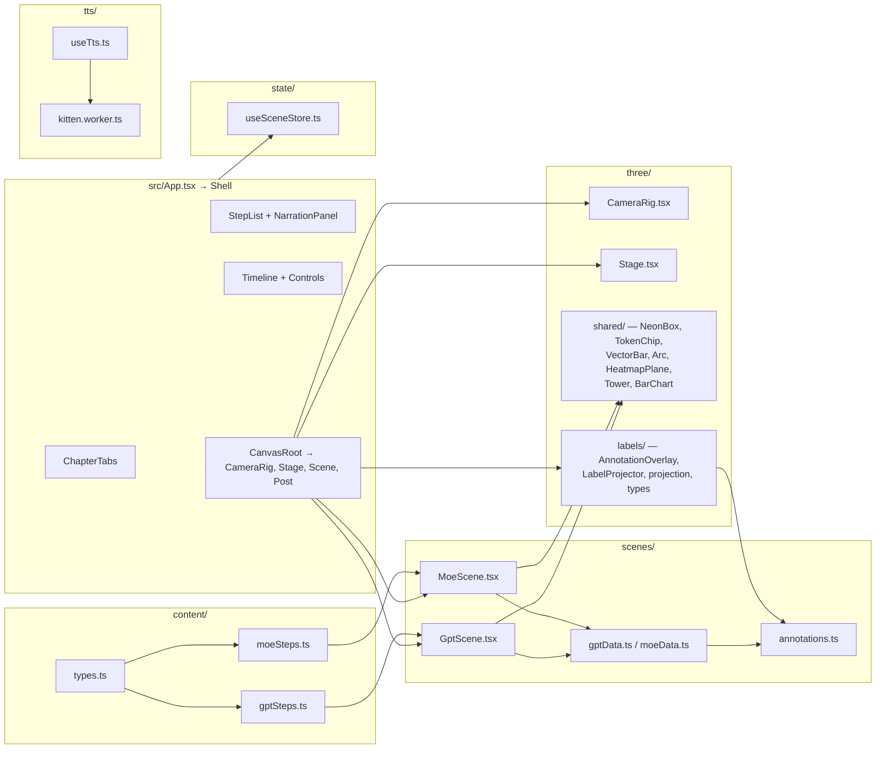

# Architecture

## What this is

A single-page 3D explainer that turns two ML ideas — **how GPT works** and **how Mixture of Experts works** — into scripted, camera-driven step sequences. The user does not read a wall of text; they watch a scene animate through 19 steps (11 GPT + 8 MoE), with narration, stats, and live sliders anchored to the right moments.

## Why this stack

| Layer | Choice | Why |
|---|---|---|
| Build | Vite + React + TypeScript | Fast HMR, trivial static build, no bundler config beyond the template. Chosen over a single HTML file because step-driven state (chapter, step, x-ray, sliders) is much easier to keep consistent in React than in imperative DOM code. |
| 3D | `three` + `@react-three/fiber` + `@react-three/drei` | Declarative scene graph that maps cleanly to "component appears at step N, dims at step M". The alternative — hand-rolled Three.js in a vanilla page — forces manual lifecycle management for every mesh. |
| Glow | `@react-three/postprocessing` (Bloom, Vignette) | One `EffectComposer` gives the neon look for free; no custom shaders. |
| State | `zustand` | A single tiny store (chapter, step, toggles, sliders) readable from both the 2D UI and inside `useFrame` loops without re-renders. Redux would be overkill for ~10 fields. |
| UI motion | `framer-motion` | Narration panel slide on step change. |
| Lint | `oxlint` (Vite template default) | Fast, zero-config. |

## System architecture

```mermaid
flowchart TB
    subgraph Shell["UI Shell (2D)"]
        CT[ChapterTabs]
        SL[StepList]
        NP[NarrationPanel]
        TL[Timeline]
        CTL[Controls]
    end
    subgraph Store["zustand store\nuseSceneStore"]
        ST[(chapter, step, playing,\nxray, labels, temperature,\ntopK, loadBalancing)]
    end
    subgraph Content["Content data"]
        GPT[gptSteps.ts — 11 steps]
        MOE[moeSteps.ts — 8 steps + chapters]
        TYP[types.ts — Step, Term, CameraPose]
        GD[gptData.ts — tokens, attention, logits]
        MD[moeData.ts — experts, gate, economics]
    end
    subgraph CanvasLayer["CanvasRoot"]
        CAM[CameraRig]
        STAGE[Stage — grid, shadows, dust]
        SCENE["GptScene / MoeScene"]
        POST[EffectComposer — Bloom + Vignette]
        LP[LabelProjector → projection.ts]
        AO[AnnotationOverlay — DOM captions]
    end
    subgraph Primitives["3D primitives (shared)"]
        NB[NeonBox]
        TC[TokenChip]
        VB[VectorBar]
        ARC[Arc — Bézier tubes]
        HM[HeatmapPlane]
        TW[Tower]
        BC[BarChart]
    end

    Shell -->|setChapter / setStep / toggles| Store
    Store -->|subscribes| Shell
    Store -->|step + camera| CAM
    Store -->|step| SCENE
    GPT -->|steps, camera, active[]| SCENE
    MOE -->|steps, camera, active[]| SCENE
    TYP --> GPT & MOE
    GD --> SCENE
    MD --> SCENE
    GD & MD -->|layout constants| ANN[annotations.ts]
    ANN --> AO
    CAM -->|damps camera pos + target| SCENE
    LP -->|projected px| AO
    SCENE --> Primitives
    Primitives -->|xray, step| Store
    STAGE --> CanvasLayer
    POST --> CanvasLayer
```

## Why content data lives outside the scene components

`gptData.ts` and `moeData.ts` hold the tokens, attention matrix, logits, expert
positions, router scores and the economics arithmetic. They are separate modules
for one practical reason: **React Fast Refresh only hot-updates a module that
exports nothing but components.** A file that exported `LOGIT_VALUES` alongside
`GptScene` was always invalidated wholesale, so editing a single number reloaded
the page and lost the step you were reading. Moving the constants out makes the
scene component hot-updatable and keeps the numbers reviewable on their own.

It also removed the last 16 lint warnings: sharing constants across a component
boundary is exactly what `react/only-export-components` objects to.

## Captions are DOM, not 3D

Captions are **not** drei `<Html>` or in-scene text. They are a plain DOM overlay
(`AnnotationOverlay`) stacked above the WebGL canvas, which is why they stay
crisp at any resolution and can use normal CSS.

The path is:

1. Each annotation declares a 3D anchor point in `annotations.ts`.
2. `LabelProjector` runs in the render loop, projects every anchor through the
   live camera, and writes CSS pixel coordinates into a module-level `Map`
   (`projection.ts`).
3. `AnnotationOverlay` reads that map each frame, measures each caption box, and
   places them with a scoring pass: candidates are tried above/below/left/right of
   the anchor, and each is scored by its clearance from *every other anchor on
   the step* — not just from other captions. This is what stops a caption landing
   on top of the geometry it is supposed to be describing.
4. An optional `place` hint on an annotation biases which side wins when only one
   caption is on screen (the common case), because with nothing to collide with,
   raw clearance alone would pick arbitrarily.

Because the whole thing re-derives every frame, it survives resizing, orbiting
and scrubbing without any stored layout.

## Data flow



## The core trick: step ranges + damping

Every visual component declares a **visibility window** `[from, to)` in step space. When the current step is inside the window the component is at full opacity; outside it scales to zero / fades. Positions never jump — they **damp** toward their target with `THREE.MathUtils.damp(cur, target, λ, dt)` inside `useFrame`.

That is what makes scrubbing backwards safe: there is no timeline of tweens to desync. The UI is a pure function of `(chapter, step)` plus a few knobs; the 3D scene is a pure function of the same state. Scrub to any step, any direction, and everything re-derives.

## The CameraRig trick

`CameraRig` damps `camera.position` and `controls.target` toward `steps[step].camera`. While gliding it sets `controls.enabled = false` so the user cannot fight the animation. The moment the camera reaches the target, or on any `pointerdown`, it hands control back to OrbitControls. Without this gate, damping and user orbit fight each other every frame.

## X-ray mode

One global boolean. Materials read it in their `useFrame`: outer shells drop to `opacity ≈ 0.12, depthWrite = false` and gain `<Edges>` outlines, while inner vectors/arcs go to full opacity. That is the "look inside the block" moment — the residual rail, the vectors inside NeonBoxes, the active experts behind dormant ones.

## File map



## Deliberate simplifications

- **Illustrative numbers only.** No tokenizer, no real weights, no model
  inference for the GPT/MoE content. The goal is a correct mental model, not a
  runnable LLM. (The *voice* is a real neural model; the *subject matter* is not.)
- **Small, countable shapes.** 6 tokens, 4 heads, 8 experts and 16 blocks are
  drawn. Real sizes are named in the narration — GPT-2 small has 12 heads and 12
  blocks; the MoE example uses 8 experts so k can be varied by hand. Where a
  drawn number differs from the model being described, the step says so.
- **One model pinned per chapter.** The GPT chapter stays on GPT-2 small so its
  figures agree with each other. Quoted numbers from other models are named.
- **No runtime test suite.** Verification is a headless-browser harness (see
  [`verification.md`](verification.md)) plus `tsc -b` and `oxlint`. A step-id typo
  shows up as an empty scene, which the harness catches by asserting every step
  renders at least one caption.
- **Two bundles, one lazy.** The neural TTS worker is a separate ~1.5 MB chunk
  plus ONNX WASM assets; it is only fetched when the user picks Kitten.

## TTS: two engines behind one interface

`useTts.ts` exposes one `speak(text)` regardless of engine:

- **System voice** — `window.speechSynthesis`. No download, but quality depends
  on the OS.
- **Kitten TTS Nano** — a 15M-parameter ONNX model run in `kitten.worker.ts` via
  onnxruntime-web. Two non-obvious details are required to make it work:

  1. **`jszip` must be pre-bundled.** Its `browser` field points at a UMD file
     with no ESM exports. The main thread gets a Vite CJS→ESM shim; the worker's
     separate module graph did not, so the worker died instantly with
     *"does not provide an export named 'default'"*. `optimizeDeps.include:
     ['jszip']` in `vite.config.ts` gives the worker the same interop.
  2. **WASM must be single-threaded.** `kitten-tts-js` sets
     `numThreads = navigator.hardwareConcurrency` immediately before creating the
     session, so setting `ort.env.wasm.numThreads` first has no effect — the
     library overwrites it. Multi-threaded WASM also requires
     `crossOriginIsolated`, which needs COOP/COEP headers, and COEP would block
     the HuggingFace model download outright. The worker therefore pins
     `navigator.hardwareConcurrency` to 1 around the model load.

## How to develop it further

- Add a step: append a `Step` object to `gptSteps.ts` / `moeSteps.ts` with a
  camera pose and `active[]` ids, then add the matching components to the scene
  with the right `[from, to)` range. Anything visible needs a caption in
  `annotations.ts` with the same range.
- Add a chapter: new `ChapterDef`, new scene file, register it in the `chapters`
  array (exported from `content/index.ts`, currently assembled in
  `moeSteps.ts`), and add a member to the `Chapter` union in `types.ts`.
- Add a knob: add a field to `useSceneStore`, a control in `NarrationPanel`, and
  read it in the scene. Keep it *derived* — read the knob and compute, never
  store a second copy of the result.
- Add a term: put it in the step's `terms[]`; the narration panel renders it in
  the glossary block automatically.

## Where things live in the home folder

- **Runtime (npm + Node):** `C:\Program Files\nodejs\` — system-wide, on PATH.
  Any app, harness, or script can run `node` / `npm`.
- **This explainer (source + docs + start/stop):**
  `C:\Users\kazir\Documents\Agentic Harness\GPT-MoE-3D-Explainer\`

To move the project, copy that whole `GPT-MoE-3D-Explainer` folder.
`node_modules/` is regenerable (`npm install`) and `dist/` is regenerable
(`npm run build`); neither needs to be copied.
